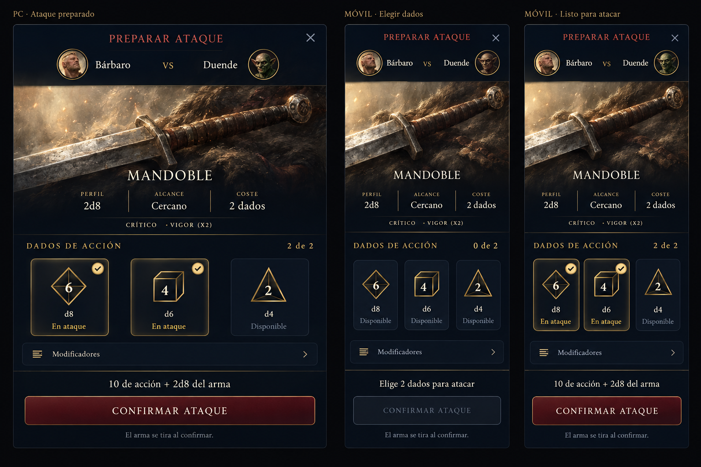

# Preparar ataque — propuesta visual 1

Estado: propuesta para revisión del usuario; no aprobada ni implementada. No modifica el HUD, su selector ni los modificadores existentes.

La composición utiliza una columna de lectura: encuentro, arma ilustrada con fundido al nombre y perfil, dados de acción, acceso a modificadores y confirmación. Las referencias son el mazo inicial para el equipo y la ficha de clase para dados y tipografía. El rojo identifica la acción ofensiva; el dorado, la selección.

Se muestran un estado preparado en PC y dos estados en móvil: ningún dado seleccionado y dos dados seleccionados. El ejemplo usa Mandoble, perfil 2d8 y coste de dos dados; los resultados de acción 6 y 4 suman 10. El perfil del arma todavía no se ha tirado y no representa daño confirmado.

Esta imagen generada es una prueba de composición. El arte, los retratos y los dados son aproximaciones visuales; una implementación debe reutilizar los recursos reales del proyecto. No demuestra animación, contraste medido ni comportamiento responsive ejecutable. En móvil se plantea contenido desplazable y confirmación accesible, que deberán comprobarse en navegador si se aprueba la dirección.

Interacción prevista: al seleccionar un dado, cambio de luz y marca de selección; actualización inmediata del gasto; activación de la confirmación al completar el coste. Los modificadores conservarán su funcionamiento y se desplegarán siguiendo el movimiento del HUD. Movimiento reducido disponible.

Generada con la herramienta integrada de imágenes. [Prompt exacto](prepare-attack-v1.prompt.txt). Referencias: `../references/initial-deck.png` y `../references/class-overview.png`.
