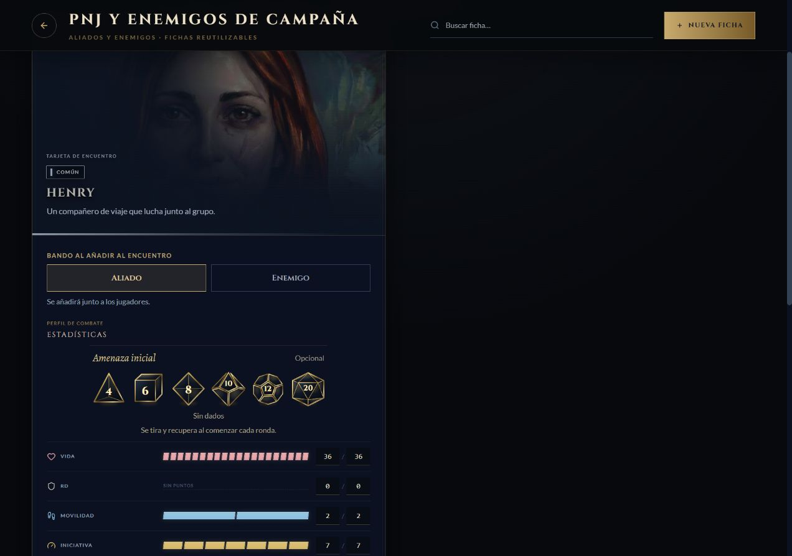

# PNJ y enemigos de Campaña

Solicitud del 22/10/2026: ampliar el archivo de PNJ con una elección guardada **Aliado / Enemigo** y desplegar cada ficha en su bando sin editar Team ID.

## Comportamiento

- Las fichas anteriores y las nuevas parten como aliadas.
- Aliado usa el equipo de los personajes del encuentro; si no hay equipo, usa `aliados`.
- Enemigo usa `enemies`, evitando coincidencias normalizadas con los equipos de los personajes.
- Se guardan los cambios pendientes antes de añadir la copia al Canvas. El encuentro conserva sus estadísticas independientes de la plantilla.

## Verificación local

La muestra importa el selector, editor y servicio de despliegue reales. Solo sustituye Firestore/Storage por adaptadores locales; no escribe partidas de producción. Usa el CSS compilado de la aplicación. Recargar restablece los datos de ejemplo.

Después de compilar la aplicación, ejecutar `node docs/design/prototypes/campaign-roster/build-preview.cjs` y servir la raíz del proyecto junto con los archivos públicos. URL de esta sesión: `http://127.0.0.1:4173/output/playwright/campaign-roster-preview.html?editor=1`.

Comprobados guardado/reapertura, despliegue de ambos bandos con «Compañía del Alba», teclado y controles de 44 px en PC y móvil. La suite completa pasa: 226 suites, 1572 pruebas correctas y una omitida. [Publicación y hashes](release.json).

