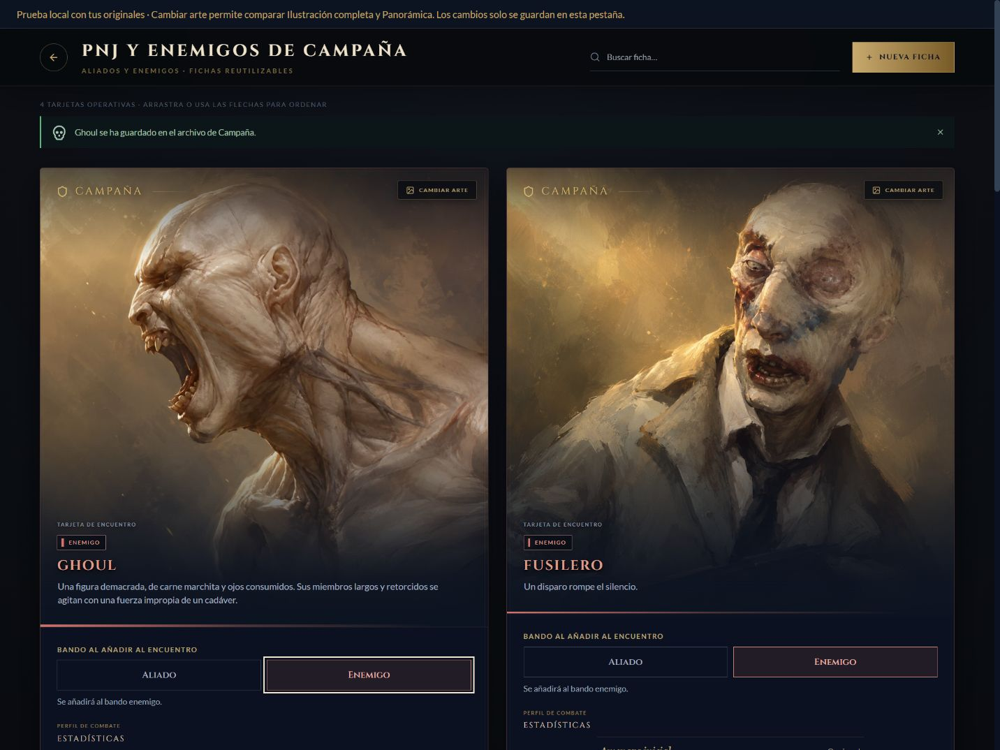

# Ilustraciones cuadradas en las tarjetas de encuentro

## Dirección

La petición conserva el estilo de NOMA y el ancho de las columnas. El problema venía del recorte 2:1 de importación, un segundo recorte `cover` al llenar la cabecera y el fundido lateral que reservaba espacio para texto.

Se ofrece **Ilustración completa** (1:1) junto a **Panorámica** (2:1), dentro de Cambiar arte. El formato cuadrado ocupa todo el ancho, mantiene la imagen sin aumento al pasar el ratón y funde su borde inferior hacia el nombre y la descripción. El texto crece bajo la imagen sin invadir el rostro. La tarjeta gana altura, no anchura.

Las fichas existentes conservan su encuadre. Las nuevas parten en cuadrado. Cambiar el formato reinicia el recorte al nuevo aspecto y conserva el original; se puede volver a abrir y ajustar. La elección, imagen derivada y porcentajes se guardan con la ficha.

En Campaña, elegir Enemigo activa el rojo de los bordes, la luz de rareza y el distintivo «Enemigo». La rareza guardada se recupera al volver a Aliado. No se aplica un filtro rojo al personaje.

### Fundido lateral

Por petición posterior del usuario, el cuadrado conserva también el fundido lateral azul noche: más profundo en el borde izquierdo, leve en el derecho y transparente hacia el centro. Se une al fundido inferior del título, sin añadir recortes ni ampliar la imagen. [Captura](evidence/art-fade-desktop.png) · [Publicación](art-fade-release.json).

## Prueba interactiva

[Abrir la prueba local](http://127.0.0.1:4173/output/playwright/encounter-art-preview.html).

La muestra utiliza el editor real y CSS compilado de producción con los originales sin modificar de Ghoul, Fusilero, Troll y Falso caballero, disponibles en la copia local bajo `output/playwright/encounter-art/`. Firestore y subida de archivos se sustituyen por adaptadores en memoria. Guardar afecta únicamente a esta pestaña; recargar restablece los ejemplos.

Construcción: `node docs/design/prototypes/campaign-roster/build-art-preview.cjs`, después de compilar la aplicación. Los originales locales deben estar en `output/playwright/encounter-art/`; no forman parte de los archivos publicados en Hosting.

La verificación cubre guardado y reapertura, cambio 1:1 ↔ 2:1, dimensiones de la imagen exportada, restauración de la rareza al cambiar de bando y PC/móvil. Suite completa: 226 suites, 1574 pruebas correctas y una omitida. Tras añadir la etiqueta accesible del botón de arte móvil, 14 pruebas dirigidas correctas.

